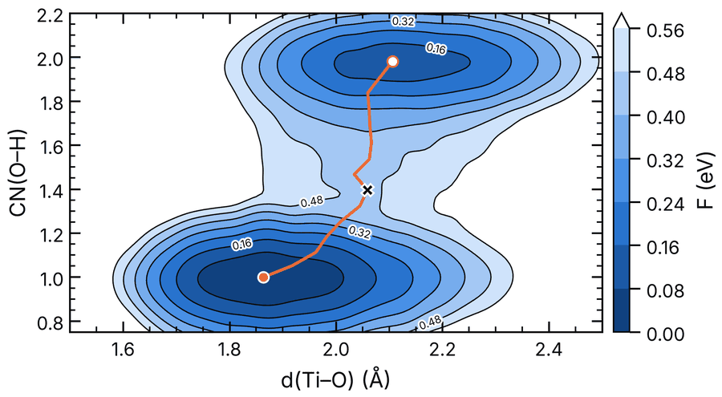
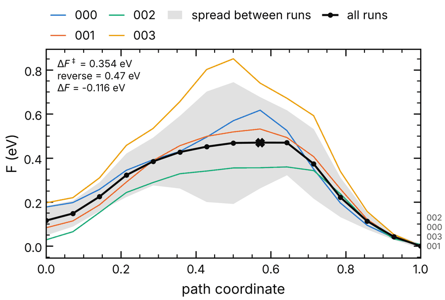
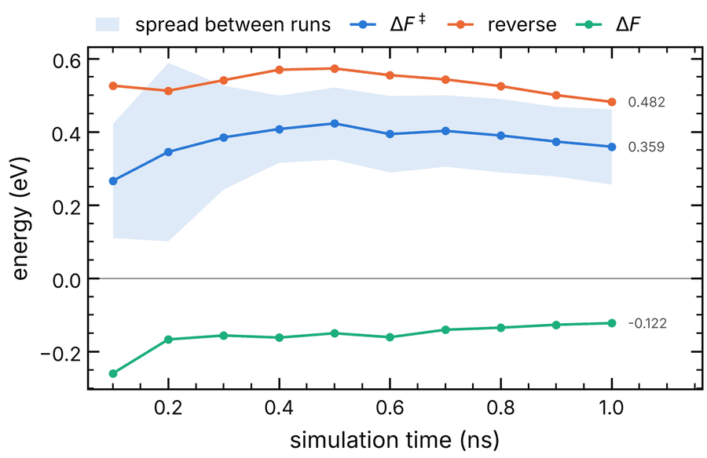

# Quick start

`estk` analyses LAMMPS + PLUMED/OPES simulations. It reweights the biased runs to free-energy
surfaces, finds the minimum energy path between two states and its barrier, checks how that
barrier converges, and draws the figures. It works from the command line (`estk ...`) and
from Python (`import estk`).

This guide follows one analysis from start to end, on four OPES runs of a water molecule on
TiO₂ with two CVs: `d0`, a Ti–O distance, and `cn`, an O–H coordination number. The output
shown is from the test runs in `tests/data/runs/`.

Contents:

1. [Install](#1-install)
2. [What estk expects](#2-what-estk-expects)
3. [Set up the project](#3-set-up-the-project)
4. [Check the runs](#4-check-the-runs)
5. [Free-energy surfaces](#5-free-energy-surfaces)
6. [Path and barrier](#6-path-and-barrier)
7. [Figures](#7-figures)
8. [Convergence](#8-convergence)
9. [From Python](#9-from-python)
10. [Files](#10-files)
11. [Common situations](#11-common-situations)

## 1. Install

```bash
git clone https://github.com/giopale/enhanced-sampling-toolkit
cd enhanced-sampling-toolkit
pip install -e '.[dev]'
estk --version
```

Python 3.10 or newer. `estk --help` lists the commands and `estk <command> --help` their
options.

## 2. What estk expects

One folder per simulation run, all under one folder:

```
my-system/
├── 000/
│   ├── log.lammps        temperature, timestep
│   ├── plumed.plumed     bias, bias factor, walls, units
│   ├── COLVAR            time, CVs, bias (e.g. opes.bias)
│   ├── CV-dOOliq_min     optional: a CV in its own file (time + value)
│   └── model_devi.out    optional: model deviation of an ML potential
├── 001/
└── ...
```

The temperature, timestep, bias factor, PLUMED walls and units are read from these files;
you don't type them anywhere. Restarted runs are fine: when a time appears twice in a file, the
last occurrence is kept.

**Multiple walkers.** A folder can also hold the walkers of one simulation, as LAMMPS
partitions (`-partition 16x...`) leave them:

```
A.mpi/
└── 000/
    ├── plumed.plumed     one input, OPES with WALKERS_MPI
    ├── State.data        one state file: the bias is shared
    ├── COLVAR.0 ... COLVAR.15
    ├── log.lammps.0 ... log.lammps.15
    └── model_devi.0.out ... model_devi.15.out
```

Each walker's files are found by its number, both `name.<i>` and `name.<i>.ext`. With
`WALKERS_MPI` the walkers share one bias, so their frames are pooled into one run: `000` gives
one surface, and every command below works on it as on a single run. Without `WALKERS_MPI`,
each walker is a run of its own (`000.w0`, `000.w1`, ...). `runs.walkers: pool` or `separate`
in `estk.yaml` sets this by hand. `estk runs` shows what was found.

## 3. Set up the project

In `my-system/`:

```bash
estk init --pattern '00*'
```

This writes `estk.yaml`, a commented project file with an entry for each CV found in COLVAR.
The file is optional and holds only facts about the system. Choices for one analysis (time
window, grid size, which CVs) are command options instead. After editing, the CV part of the
example looks like this:

```yaml
runs:
  root: "."
  pattern: "00*"

cv:
  d0:
    label: d(Ti–O)        # axis label
    units: Å
    limits: [1.5, 2.5]    # grid range
  cn:
    label: CN(O–H)
    limits: [0.75, null]  # null: from the PLUMED wall, else from the data

reaction:
  start: {cn: 2.0}        # paths start at the minimum nearest cn = 2 (molecular water)
```

The other keys are:

- `cv.<name>.bandwidth`: the kernel bandwidth.
- `cv.<name>.scale`: a factor applied when loading, e.g. radians to degrees.
- `cv.<name>.source`: the file holding the CV.
- `simulation.*`: values that can't be read from the run files.
- `atoms`: type map and atom groups.
- `plot.style`: the figure style.

`estk init` writes all of these, commented.

To check the file:

```bash
estk config validate     # OK, or what is wrong and where
estk config show         # every setting in effect and where it comes from
```

Coming from the old Hydra scripts:

```bash
estk config migrate to_refactor/config/case/atio2-h2o.yaml -o estk.yaml
```

The migration keeps the facts about the system and lists the settings it left out, with
where each now lives.

## 4. Check the runs

What was read from the simulation files:

```console
$ estk runs
 run   T (K)   timestep (ps)   bias        bias factor   walls                        units
 000   350     0.0005          opes.bias   22.3363       cn [-, 2.2], d0 [1.5, 2.2]   1, kj/mol
 001   350     0.0005          opes.bias   22.3363       cn [-, 2.2], d0 [1.5, 2.2]   1, kj/mol
 ...
```

The data, per run:

```console
$ estk cvs d0 cn
 run   rows   time (ns)   d0              cn          past walls
 000   2121   0 – 1.06    1.514 – 2.57    0 – 1.999   d0 upper 2.2: 457 frames, max 14.1 kT
 ...
```

"Past walls" counts the frames beyond a PLUMED wall and the largest wall energy among them.
These frames are reweighted with the OPES bias only, because the wall energy is not in
`opes.bias`. See [Common situations](#11-common-situations).

How the OPES bias evolved:

```console
$ estk check opes
 run   time (ns)   opes.rct   opes.zed   opes.neff   opes.nker   rct change, last quarter (kj/mol)
 000   1.06        2.277      0.006335   912.7       1633        -0.554
 001   1.08        1.943      0.007604   995.9       1779        -0.0187
 ...
wrote opes.png
```

A converged OPES run has an almost constant c(t) (`rct`). The figure shows `rct`, `zed`,
`neff` and `nker` against time for every run.

For simulations with an ML potential, `estk check model-deviation --levels 0.2,0.35` gives the
fraction of frames below, between and above the two trust levels, and plots the deviation
against time with its distribution.

## 5. Free-energy surfaces

```console
$ estk reweight d0 cn -j 4
grid d0: 1.5 (estk.yaml) to 2.5 (estk.yaml), 100 points
grid cn: 0.75 (estk.yaml) to 2.2 (PLUMED walls), 100 points
 run   frames   n_eff   h(d0)       h(cn)       weight   past walls
                        silverman   silverman
 000   2121     81      0.02018     0.05799     0.256    d0 upper 2.2: 457 frames, max 14.1 kT
 001   2152     92      0.01794     0.04884     0.199    ...
 002   2122     30      0.0207      0.04843     0.051
 003   2102     186     0.01644     0.04333     0.495
runs combined with mode 'probability' -> combined.dat
wrote 5 file(s) to reweight-d0-cn/
```

This writes one surface per run, `reweight-d0-cn/000.dat` ..., and all runs combined,
`reweight-d0-cn/combined.dat`. `n_eff` is the effective number of frames after reweighting and
`weight` each run's share of the combined surface. Options:

| Option | What it does |
|---|---|
| `estk reweight d0` | a 1D profile (from 1D or 2D biased runs) |
| `--time 0 0.5` | only frames in this window (ns) |
| `--points 100,80` | grid points per CV |
| `--limits d0=1.5,2.2` | grid range, instead of estk.yaml / walls / data |
| `--bandwidth d0=0.02` | kernel bandwidth of one CV |
| `--bandwidth scv` | bandwidths by smoothed cross-validation (or `silverman`) |
| `--include-walls` | add the PLUMED wall energies to the bias |
| `--combine equal` | each run counts the same (default `probability`: as if all frames were one run; `legacy`: as the old scripts) |
| `--property max_devi_f --source model_devi.out` | average of a quantity instead of the free energy |
| `--blocks 4` | split each run into 4 time blocks (`000.b1`, ...): their spread is an error bar for one simulation |
| `--compress` | write `.dat.gz` files |
| `-o folder` | output folder |

**Bandwidths.** `estk.yaml` values are used when present, otherwise Silverman's rule. To
compare the choices:

```console
$ estk bandwidth d0 cn
 run   frames   n_eff   h(d0)       h(cn)       h(d0)    h(cn)
                        silverman   silverman   scv      scv
 000   2121     81      0.0202      0.058       0.0497   0.109
 ...
 all   8497     379     0.0159      0.0454      0.0421   0.077
estk.yaml (used by estk reweight): d0=-, cn=-
```

`estk bandwidth d0 cn --save` writes the all-runs SCV values into `estk.yaml`. Only the
`bandwidth:` lines are changed; comments and layout are kept.

**Recombining** the per-run surfaces in another mode needs no new reweighting:

```bash
estk combine reweight-d0-cn/0*.dat -m equal -o equal.dat
```

**What is in a file:**

```bash
estk info reweight-d0-cn/combined.dat
```

This prints the grid, the range of values and how the file was made: the command, temperature,
bandwidths, runs and their weights, and time ranges.

## 6. Path and barrier

```console
$ estk mep reweight-d0-cn/combined.dat
 minimum   d0      cn      F (kj/mol)   depth (kT)
 1         1.864   0.999   0.000        global
 2         2.106   1.98    11.208       11.81
path from (d0=2.106, cn=1.98) to (d0=1.864, cn=0.999), 15 images
ends: start nearest cn=2 (reaction.start); end the lowest other minimum
barrier          34.161 kj/mol = 0.3540 eV = 11.74 kT
reverse barrier  45.369 kj/mol = 0.4702 eV = 15.59 kT
reaction         -11.208 kj/mol = -0.1162 eV = -3.85 kT
barrier on each run along this path (kj/mol): 000: 42.44, 001: 43.29, 002: 31.94, 003: 63.12
  spread between runs: 11.27 kj/mol
wrote reweight-d0-cn/combined.mep.dat
```

- **Minima.** These are minima whose basin is at least 2 kT deep (`--min-depth`), so noise
  doesn't count.
- **Direction.** The path starts at the minimum nearest `reaction.start` in `estk.yaml`, and
  `barrier` is measured from that start. Set `reaction.end` too if the end isn't the lowest
  other minimum. Without `reaction.start`, the path joins the two lowest minima, the one with
  the smaller first CV first.
- **Run profiles.** The path is also evaluated on each run's surface; the spread between the
  runs is a quick error estimate.
- **Other options:**
  - `--reverse` swaps the ends.
  - `--start 2.1,1.98 --end 1.86,1.0` gives the ends by hand.
  - `--via` adds a point the initial path goes through, and `--minima 3` goes through the
    third minimum.
  - `--images` sets the number of points along the path.
  - `--method split` reproduces the old scripts' choice of ends.

## 7. Figures

```bash
estk plot surface reweight-d0-cn/combined.dat --path reweight-d0-cn/combined.mep.dat --units eV
estk plot path reweight-d0-cn/combined.mep.dat --units eV
estk plot surface reweight-d0-cn/0*.dat --units eV -o runs.png    # all runs side by side
```



On the path, the open circle is the start, the filled one the end and the cross the highest
point.



Options:

- `--units` sets the energy units: kJ/mol, kcal/mol, eV or kT.
- `--step 0.1` puts contours at fixed intervals, and `--levels 0,0.1,0.2,0.4` at given ones.
- `--vmax` sets the top of the colour scale.
- `--contour-labels all|some|none` controls the numbers on the contour lines.
- `-o fes.pdf` sets the output; the extension sets the format, and the option can be repeated.
- `--style` chooses the look: `paper` (single-column journal figure, the default), `slides`,
  or your own `.mplstyle` file. Axis labels come from `cv.<name>.label` and `units` in
  `estk.yaml`.

## 8. Convergence

How the barrier changes as more simulation time is used:

```bash
estk convergence time d0 cn --until 1.0 --step 0.1 --units eV -j 4
```



Each step reweights the first 0.1, 0.2, ... ns of every run and measures the barrier along
the path of the full data. `--relax` computes a new path at each step instead, `--start 0.2`
drops equilibration, and the band is the spread between runs. The table and the figure go to
`convergence-d0-cn-time/`.

Against the bandwidth of one CV:

```bash
estk convergence bandwidth d0 cn --cv d0 --range 0.005 0.08 --num 10 --units eV
```

## 9. From Python

Everything the commands do is available as functions returning objects:

```python
import estk
from estk import Project

project = Project()                                   # the nearest estk.yaml
for run in project.runs:
    print(run.name, run.metadata.temperature, run.metadata.bias_factor)

tables = project.load_cvs(["d0", "cn"], time=(0, 0.5))
tables[0]["d0"], tables[0].bias, tables[0].kbt       # arrays per run

result = project.reweight(["d0", "cn"])               # same options as estk reweight
fes = result.combined                                 # .grid, .values (kJ/mol), .error, .metadata
result.save("reweight-d0-cn")

from estk.paths import minimum_energy_path
path = minimum_energy_path(fes, start_near=project.config.reaction.start)
path.barrier, path.reverse_barrier, path.points
path.save("reweight-d0-cn/combined.mep.dat")

fes = estk.load("reweight-d0-cn/combined.dat")        # a Surface, or a path for a .mep.dat

from estk.plotting import plot_style, plot_surface, plot_path_profile
with plot_style("paper"):
    ax = plot_surface(fes, path=path, units="eV")     # a matplotlib Axes, to adjust or save
    ax.figure.savefig("fes.pdf")

from estk.analysis import barrier_convergence
conv = barrier_convergence(project, ["d0", "cn"], "time", [0.25, 0.5, 1.0])
[row.barrier for row in conv.rows]
```

## 10. Files

All output files are text: PLUMED-style grids and columns, with a header that records how
they were made, including the estk version and the command. A name ending in `.gz` is
gzip-compressed.

| File | Written by | Contents |
|---|---|---|
| `reweight-<cvs>/<run>.dat` | `estk reweight` | one run's free energy (or property) on the grid |
| `reweight-<cvs>/combined.dat` | `estk reweight`, `estk combine` | all runs combined, with the spread between runs |
| `<surface>.mep.dat` | `estk mep` | path points, free energy along them, each run's profile |
| `<surface>.png`, `<path>.mep.png` | `estk plot` | figures |
| `convergence-<cvs>-<parameter>/` | `estk convergence` | table, figure, reference path |
| `opes.png`, `model_deviation.png` | `estk check` | diagnostic figures |

Energies are stored in the units of the bias (kJ/mol here) and converted only for display.
Grids written by the old scripts (`pot*-rew-fes.dat`, `*-AVG.dat`) can be read by every command.

## 11. Common situations

**Frames past a PLUMED wall.** The walls confine the system, and the frames beyond them carry
the wall energy, which is not in the OPES bias. Either keep the grid inside the wall
(`--limits d0=1.5,2.2`) or add the wall energies to the bias with `--include-walls`. They are
computed from the wall definitions in the PLUMED input and the CV values.

**A minimum at the edge of the grid.** Sparse frames at the edge of the sampled range can form
a deep spurious minimum. In the example, without `cn: limits: [0.75, null]` a minimum appears
at cn = 0. Set the limits, or use `reaction.start`/`reaction.end`, which pick the right states
among all the minima.

**Few effective frames.** `n_eff` in the `reweight` table is the number of frames that
effectively count after reweighting. When it is small (tens), surfaces and barriers are noisy;
the spread between runs and `estk convergence time` show how much.

**Error bars for one simulation of walkers.** Walkers that share a bias are not independent,
so the spread between them is no error bar. Use time blocks instead:

```bash
estk reweight d0 cn --blocks 4
estk mep reweight-d0-cn/combined.dat     # barrier on each block, and their spread
```

The `probability` combination of the blocks is the surface of the whole simulation. The spread
between blocks is about √4 times the standard error of that surface. Drop the start-up period
first (`--time <start> inf`, see `estk check opes`), so the blocks don't include it. Two
independent multi-walker simulations (`000/`, `001/`) give an error bar that doesn't depend on
the bias having settled.

**Choosing bandwidths.** Results should not depend much on them. Check with
`estk convergence bandwidth`. `--bandwidth scv` fits them to the data by smoothed
cross-validation on the biased frames. `scv-weighted` fits the reweighted frames instead, but
with few effective frames it smooths the barrier away.

**A setting is read wrongly** (temperature, timestep, bias column or units): `estk runs` shows
what was read. Set the right value under `simulation:` in `estk.yaml`.

**More detail:** `estk -v <command>` prints debug messages and full tracebacks.

---

Not there yet: CVs averaged along the path, structure extraction near a point or in a basin,
proton-transfer CVs and the standalone conversion tools. See [REFACTOR.md](../REFACTOR.md) for
their status.
